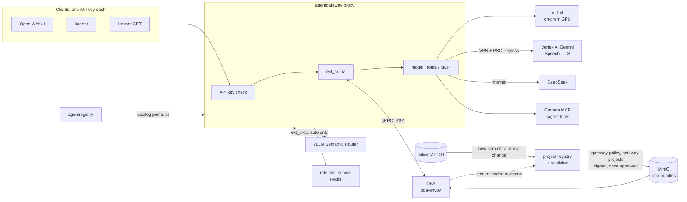

# Model and tool gateway: agentgateway, OPA, the project registry, agentregistry

Every model call and every shared MCP tool call on the platform goes through one
gateway, [agentgateway](https://agentgateway.dev). Before routing a request, the
gateway asks OPA whether this client may use this model or tool. OPA's policy is
Rego in this repo; each project's data lives in the
[project registry](https://github.com/nolimitkun/project-registry/blob/main/docs/design.md). The registry publishes both as signed
bundles, each change after an approval. OPA loads the two bundles together and
verifies both signatures. agentregistry is the catalog
where people find the tools.

agentgateway replaces LiteLLM, which this platform used before.



## The pieces

| Piece | Argo CD app | What it does |
|-------|-------------|--------------|
| agentgateway controller | `agentgateway`, `agentgateway-crds` | Creates the GatewayClass `agentgateway`. For each Gateway, it runs a proxy Deployment, Service and ServiceAccount named after the Gateway |
| Gateway config | `agentgateway-config` (`minikube/gitops/agentgateway-config`) | The `agentgateway-proxy` Gateway, the merged MCP endpoint, and policies for API keys, OPA, the semantic router, rate limits, the model list, metrics labels and tracing |
| Model routes | `gateway-models` (a chart from the project registry's Helm repository in MinIO) | One `AgentgatewayModel` per model, the `auto` virtual models and the passthrough routes to Google's APIs, from the approved policy's catalog (gateway-policy's `charts/gateway-models`) |
| OPA | `opa-policy` (`minikube/gitops/opa-policy`) | `opa-envoy`, answering ext_authz over gRPC on `opa:9191` |
| Project registry | `project-registry`, `project-registry-postgresql` | Publishes both of OPA's bundles, signed with Vault Transit, to MinIO (`opa-bundles/`). Projects, agents and exceptions are change requests with approvals (`gateway-projects`). A new commit of `policies/gateway` on `main` is a policy change request, tested and replayed, published once approved (`gateway-policy`). A portal at `registry.test/portal/`, and a daily export of the records to Git as a PR ([its design](https://github.com/nolimitkun/project-registry/blob/main/docs/design.md)) |
| Rate-limit service | `rate-limit` (`minikube/gitops/rate-limit`) | Counts each project's requests, tokens and spend in Redis; the limits come from OPA with each request (see "Rate limits and budgets") |
| vLLM Semantic Router | `semantic-router` | Classifies `auto` prompts into task classes for the gateway, over ext_proc (see "The semantic router") |
| agentregistry | `agentregistry`, `agentregistry-postgresql`, `agentregistry-catalog` | The catalog of MCP servers (and later agents), at `agentregistry.test` behind the Keycloak login. Its entries live in `minikube/gitops/agentregistry-catalog/files/catalog.yaml` |

Endpoints inside the cluster:

- Models: `http://agentgateway-proxy.mini-platform.svc.cluster.local/v1` (OpenAI API:
  `/chat/completions`, `/models`, `/responses`, `/messages`, `/embeddings`).
- Tools (MCP, streamable HTTP): `http://agentgateway-proxy.mini-platform.svc.cluster.local/mcp`.
- Google APIs: `http://agentgateway-proxy.mini-platform.svc.cluster.local/google/<api>/...`.

Outside the cluster, the same endpoints are at `http://agentgateway.test`.

## Models

| Model | Where | Placement |
|-------|-------|-----------|
| `qwen3.6-27b` | vLLM on the local GPU | `onprem` |
| `gemini-4-argon`, `gemini-3.8-flash`, `gemini-3.5-flash`, `gemini-3.5-flash-lite` | Vertex AI `eu`, through `aiplatform.eu.rep.googleapis.com` and the VPN | `gcp` |
| `deepseek-v4-pro` | `api.deepseek.com` over the internet | `external` |

The names are the ones LiteLLM used, so no client had to rename a model.

Every model and Google API is declared once, in the model catalog
[`catalog/models.yaml`](https://github.com/nolimitkun/gateway-policy/blob/main/catalog/models.yaml) of the gateway policy
([nolimitkun/gateway-policy](https://github.com/nolimitkun/gateway-policy)), with
its placement and provider settings. Its `scripts/gen-catalog.py` validates the
catalog and generates two files from it:

- `generated/agentgateway-catalog.yaml`, the values of the policy's
  `charts/gateway-models`: an `AgentgatewayModel` per model, the `auto` models
  and the Google API routes. Once a policy commit is approved and active, the
  project registry packages that chart with this catalog and publishes it to
  its Helm repository in MinIO (bucket `gateway-models`); the Argo CD
  application `gateway-models` here installs the newest version, with the
  gateway's own values (`minikube/values/gateway-models-values.yaml`).
- `policies/gateway/catalog/data.json`, which OPA reads as `data.catalog` for
  placements.

A model therefore can't be routed without a placement, or allowed without a
route.

To add a model or a Google API:

1. For a self-hosted model, its serving release first (the onboarding
   pipeline, `model-serving`).
2. In gateway-policy: add it to `catalog/models.yaml`, run
   `python3 scripts/gen-catalog.py`, and merge. The project registry files the
   commit as a policy change; once it is approved, OPA knows the model's
   placement and the registry publishes the routes (a new `gateway-models`
   version), which Argo CD installs within about three minutes. Until then a
   call gets 404 (no route) or 403 (not allowed yet): both fail closed.

Nothing here changes for a new model. This repo's CI checks its own side against
the policy's `main` (`scripts/check-policy-wiring.py`: MCP targets, serving
namespaces, the semantic router's decisions).

### Self-hosted models (KServe)

Models on the local GPU are served by KServe `LLMInferenceService`s that the
model onboarding pipeline (`model-onboarding-pipeline`) creates. The platform's
`model-serving` app (`minikube/gitops/model-serving`) owns what they run in:

- the namespaces `model-onboarding` (the pipeline) and `model-hprd` /
  `model-prod` (the serving namespaces, listed as `servingNamespaces` in
  `catalog/models.yaml`);
- their credentials, from Vault through VSO: the pipeline's gateway key
  (`gateway-key`) and MinIO account (`s3-creds`), and in each serving namespace
  the read-only MinIO account (`model-weights-s3`) and the vLLM key
  (`model-serving-key`);
- an `AgentgatewayPolicy` that sends the vLLM key on the routes KServe creates.

KServe itself is platform GitOps as well, cluster-wide: the Gateway API CRDs,
cert-manager, LWS and KServe's LLMInferenceService controller with its
`LLMInferenceServiceConfig` presets (`kserve-*` apps in
`minikube/gitops/mini-platform/values.yaml`). It deploys no model on its own.

There is one gateway: KServe attaches each service's HTTPRoute
(`/<namespace>/<name>/v1/...`) to `agentgateway-proxy`, whose listener admits
routes from the serving namespaces. The InferencePool's endpoint picker (EPP)
chooses the vLLM replica; this needs the controller's inference extension
(`inferenceExtension.enabled` in `agentgateway-values.yaml`).

Two ways in:

- **By model name**, for everyone. A catalog entry with `provider: KServe`
  names a release (`deployment: model-prod/<name>`) and the name vLLM serves
  (`servedModel`). The chart renders an `AgentgatewayModel` next to the pool
  that rewrites the model name, so clients keep using the catalog name and a
  new release is a one-line catalog change. KServe models must be `onprem`.
- **By deployment path**, for the pipeline only. OPA allows
  `/<serving namespace>/...` to projects with `deployments: true` and on-prem
  placement (`model-onboarding`), never to agent keys. The pipeline evaluates
  and tunes candidates there before any catalog entry points at them.

Weights live in MinIO, bucket `models` (versioned, object locking), at
`s3://models/<repo>/<revision>/`. The pipeline's account can write but not
delete; the serving account can only read. vLLM streams the weights from MinIO
(`--load-format runai_streamer`); nothing is copied to a volume first.

### Google login without a key

The proxy runs as the ServiceAccount `agentgateway-proxy`. Its projected token is
exchanged for a Google token through the `onprem-k8s` workload identity pool,
then impersonates `litellm-stt` (`GOOGLE_APPLICATION_CREDENTIALS`, set by
`AgentgatewayParameters`). Google accepts only the subjects listed in
mini-cloud's `infra/modules/gcp-stt-poc` `k8s_subjects`. Renaming the Gateway
breaks this until that list is updated.

### Speech and other Google APIs

agentgateway doesn't translate OpenAI `/v1/audio` calls into Speech or TTS
calls the way LiteLLM did. Instead, clients call Google's own APIs through the
gateway, which adds the Google token:

| Route | Google API |
|-------|------------|
| `/google/speech/...` | Speech-to-Text v2, Chirp 3, `eu-speech.googleapis.com` |
| `/google/tts/...` | Text-to-Speech, Chirp 3 HD voices, `eu-texttospeech.googleapis.com` |
| `/google/vertex-eu/...` | Vertex AI `eu`, for Gemini TTS through `generateContent` |
| `/google/vertex-europe-west1/...` | Vertex AI `europe-west1`, for the Gemini Live websocket |

For example, a TTS call:

```bash
curl -s http://agentgateway.test/google/tts/v1/text:synthesize \
  -H "Authorization: Bearer $KEY" -H 'content-type: application/json' \
  -d '{"input":{"text":"Bonjour"},"voice":{"languageCode":"fr-FR","name":"fr-FR-Chirp3-HD-Aoede"},"audioConfig":{"audioEncoding":"MP3"}}'
```

## Projects and keys

> **The projects, agents and exceptions live in the
> [project registry](https://github.com/nolimitkun/project-registry/blob/main/docs/design.md)**, not in this repo: change them in
> its portal at `http://registry.test/portal/` or through its API (a change
> request, approved by policy, published within about a minute). The gateway
> policy ([nolimitkun/gateway-policy](https://github.com/nolimitkun/gateway-policy)) has
> their format ([`projects/schema.json`](https://github.com/nolimitkun/gateway-policy/blob/main/projects/schema.json),
> [`agents/schema.json`](https://github.com/nolimitkun/gateway-policy/blob/main/agents/schema.json)), the renderer
> (`scripts/gen-projects.py`); this repo has the seed a new cluster's registry starts
> with (`minikube/gitops/project-registry/files/seed.yaml`). The API key ids for
> Vault, agentregistry's agent catalog and the data for a replay all come from
> the registry.

Every API key belongs to a **project**. A project record, in the format of
[`projects/schema.json`](https://github.com/nolimitkun/gateway-policy/blob/main/projects/schema.json):

```yaml
project: holmes
owner: platform team
data_class: internal            # caps placement (see below)
placement: [onprem]             # optional; may only narrow the class
models:
  allow: ["gemini-3.5-*"]       # optional, default ["*"]; globs over catalog names
routing: cheapest               # optional, for model "auto": cheapest | fastest | semantic | fixed:<model>
limits:                         # optional; shared by all the project's keys
  requests_per_minute: 60
  tokens_per_minute: 200000
budget:                         # optional
  usd_per_30_days: 25
keys: [holmes, holmes-2]        # key ids; the secrets are in Vault
mcp_tools: ["grafana_*"]        # optional; no MCP access without it
deployments: false              # optional; true: may call KServe deployment paths
                                # (needs onprem placement; see "Self-hosted models")
```

The policy's `scripts/gen-projects.py` validates the records, including rules
across them (the registry runs it on every change, at the active policy commit):

- the record's name is the project id
- placement stays within the data class
- every `models.allow` pattern matches a catalog model
- a `fixed:<model>` routing names a model the project may use
- key ids are `<project>` or `<project>-<suffix>`, and unique
- exceptions name existing projects and models
- `deployments: true` only with `onprem` in the placement

It then renders the `gateway-projects` bundle, which the registry signs and
publishes:

| File in the bundle | Read by |
|------|---------|
| `projects/<id>/data.json`, one per project | OPA, as `data.projects.<id>` |
| `exceptions/<id>/data.json`, one per project with an exception | OPA, as `data.exceptions.<id>` |
| `agents/<id>/data.json`, one per agent | OPA, as `data.agents.<id>` |

To see it locally: `python3 "$(scripts/policy-checkout.sh)/scripts/render-records.py" minikube/gitops/project-registry/files/seed.yaml --out /tmp/gateway-projects`.
The rate-limit config (`minikube/gitops/rate-limit/files/config.yaml`) and the
alert rules (`app-resources/alerts/agentgateway-projects.yml`) list no project
and are edited by hand.

Today's projects are the four former clients and the onboarding pipeline, each
with one key whose id is the project id:

| Project | Data class | Routing for `auto` | Mirror (env name the client reads) |
|---------|------------|--------------------|------------------------------------|
| `open-webui` | `internal` | `semantic` | `open-webui-agentgateway` |
| `kagent` | `internal`, plus the DeepSeek exception | `cheapest` | `kagent-agentgateway` |
| `holmes` | `internal`, plus the DeepSeek exception | `cheapest` | `holmes-agentgateway` |
| `admin` | `public` | `semantic` | none: for people |
| `model-onboarding` | `internal`, on-prem only, `deployments: true` | none | `model-onboarding-agentgateway` (VSO puts it in `model-onboarding/gateway-key`) |

Their limits and budgets are under "Rate limits and budgets".

Keys are created by `scripts/bootstrap-vault-secrets.sh`, which reads the key
ids with `gen-projects.py --keys`, so it needs python3 with PyYAML and
jsonschema:

- `mini-platform/agentgateway-api-keys` is what the gateway reads: one entry per
  key id, `{"key": ..., "metadata": {"project": ..., "key_id": ...}}`.
- `mini-platform/agentgateway-client-keys` holds the raw keys under the same
  ids.

To add a project, request it in the project registry's portal. Once it is
published, run the bootstrap with `SEED_MISSING_ONLY=true` to create its keys
(it reads the key ids from the registry).

To rotate a key:

1. Add a second id, such as `holmes-2`, and create it with the bootstrap.
2. Move the client to the new key.
3. Remove the old id from the project file. OPA refuses the old key as soon as
   the new bundle is live (`key holmes is not active for project holmes`). The
   next bootstrap run drops it from Vault.

## Agents

A project is a budget and a data class; an agent is one thing acting inside
it. `agents/<id>.yaml` registers an agent (schema `agents/schema.json`):

```yaml
agent: kagent-k8s-agent
project: kagent              # data class, placement, limits, budget come from here
owner: platform team
description: Inspects and changes Kubernetes resources ...   # its mission
runtime: {kind: kagent, name: k8s-agent}
autonomy: autonomous         # read-only | supervised | autonomous
keys: [kagent-k8s-agent]     # its own gateway keys
models:
  allow: [deepseek-v4-pro]   # narrows the project's models
mcp_tools: []                # narrows the project's MCP tools; absent = none
secret: {name: kagent-k8s-agent-agentgateway, field: OPENAI_API_KEY}
```

An agent can only narrow its project. A call with one of its keys gets:

- the project's models, narrowed by the agent's `models.allow` (`lib.scoped`);
  `auto` chooses within them too, since the gateway passes the key id to OPA;
- MCP tools that match both the project's and the agent's patterns, and no MCP
  at all if the agent lists none;
- the project's rate limit and budget, shared with the project's other keys.

Denials name the agent, for example `model qwen3.6-27b is not allowed for agent
kagent-k8s-agent (project kagent)`.

### Tool risk and autonomy

The policy's `catalog/tools.yaml` (gateway-policy) lists every tool behind `/mcp` (189 today: Grafana MCP and
kagent-tools) with the most it can do:

| Risk | Meaning | read-only agent | supervised agent | autonomous agent |
|------|---------|-----------------|------------------|------------------|
| `read` | only reads | yes | yes | yes |
| `write` | changes something that can be changed back | no | needs approval | yes |
| `irreversible` | deletes, uninstalls, runs arbitrary commands or API calls | no | needs approval | needs approval |

An agent's tool call needs a match in its project's and its own `mcp_tools`
and a risk its `autonomy` allows. A tool the catalog doesn't list counts as
`irreversible`, so a new or renamed tool stays out of agents' reach until
someone classifies it. There is no approval path through the gateway yet, so
"needs approval" is a 403 that says so: `tool grafana_update_dashboard is write:
agent holmes (supervised) needs a human approval for it`. A project's own keys
keep the plain `mcp_tools` rule; risk applies to agents.

The servers' own MCP annotations aren't trusted. kagent-tools marks every tool
destructive (the MCP default when a server sets no `readOnlyHint`), and
Grafana's `alerting_manage_routing` claims read-only though it can change
routing. A tool that can do several things is classed by the worst one.

Each entry also has a `fingerprint`, a hash of the description and input
schema the server announced when it was classified. The policy repo's `scripts/tools-drift.py`
lists the live tools through the gateway and reports tools that are new,
removed or changed since; run it after upgrading kagent or Grafana MCP, and
before trusting a changed tool, re-check its risk. `gen-catalog.py` puts the
risks into the policy's `data.catalog.tools`.

`gen-projects.py` adds each agent's keys to its project with an `agent_keys`
map (key id → agent) and writes `data.agents.<id>` into the `gateway-projects`
bundle, so registering, changing or removing an agent touches only its own
files. It also checks the wiring a kagent agent needs: a `modelConfigRef` in
`kagent-values.yaml` naming a ModelConfig in `kagent-resources.yaml`
`extraObjects` that reads the agent's secret, listed in `vaultSecrets`.
`bootstrap-vault-secrets.sh` writes each agent's key to its `secret`
(`gen-projects.py --mirrors`), and every agent appears in agentregistry as an
`Agent` (`agentregistry-catalog/files/agents.yaml`, generated).

Registered today:

| Agent | Project | Autonomy | Models | MCP tools |
|-------|---------|----------|--------|-----------|
| `kagent-k8s-agent` | kagent | autonomous | `deepseek-v4-pro` | none through the gateway |
| `kagent-helm-agent` | kagent | autonomous | `deepseek-v4-pro` | none through the gateway |
| `kagent-promql-agent` | kagent | read-only | `deepseek-v4-pro` | none through the gateway |
| `kagent-observability-agent` | kagent | read-only | `deepseek-v4-pro` | none through the gateway |
| `holmes` | holmes | supervised | `deepseek-v4-pro` | `grafana_*` |

kagent's agents still call their MCP servers directly, not through the gateway
(see "MCP and agentregistry"), so their tool use isn't scoped here yet. The
`kagent` project keeps its own key for `default-model-config`, which agents
created in kagent's UI use until they are registered: they get the project's
scope.

To register an agent: wire its runtime to the key here (for kagent, the three
places above) and merge, then request the agent in the project registry. Once
it is published, run the Vault bootstrap (`SEED_MISSING_ONLY=true` creates the
new key). The registry checks a proposed agent against the policy's rules and,
for a kagent agent, against the wiring on this repo's `main`, so the wiring
merges first; this repo's CI checks the seed's kagent agents the same way.

## Policy

> The paths in this section (`policies/gateway/...`, `catalog/...`) are in the
> gateway policy's repository, [nolimitkun/gateway-policy](https://github.com/nolimitkun/gateway-policy).

`policies/gateway/authz.rego` decides each request from:

- `data.projects`, `data.exceptions` and `data.agents`, the project registry's
  records rendered by `scripts/gen-projects.py` (the `gateway-projects` bundle)
- `data.catalog`, generated from `catalog/models.yaml`
- `data.gateway.classes` in `policies/gateway/data.json`, which maps each data
  class to the placements it may use

The rules:

- **Data classes,** as in mini-cloud's `docs/gcp/ai-inference.md`:
  - `restricted` and `confidential`: `onprem` only
  - `internal`: `onprem` and `gcp`
  - `public`: also `external`

  A project may use a model if the model's placement is in the project's
  placement (capped by its class) and the name matches `models.allow`.
- **Exceptions** (records in the project registry, approved by security). A
  project can get named models outside its class, each with an owner and a
  reason. Today kagent and Holmes have one for DeepSeek.
- **Keys.** The key's id must be listed in its project's record.
- **Google APIs.** Allowed when the API's placement (`gcp`) is in the project's
  placement.
- **MCP.** A project with `mcp_tools` may open sessions and list tools. Each
  `tools/call` must name a tool that matches one of its patterns, such as
  `grafana_*`. Tool names carry the target's prefix: `grafana_...` or
  `kagent-tools_...`.
- **Everything else** is denied, with a 403 whose body gives the reason:
  ```json
  {"error":{"message":"model deepseek-v4-pro is not allowed for project open-webui (internal data)","type":"policy_denied"}}
  ```

### The model list

`GET /v1/models` shows each project only the models it may call, plus `auto`
and `auto-<task>` when it has any. Open WebUI's model picker is that list.

For that path OPA's decision adds a request header, `x-allowed-models`,
naming the project's models (`listed_models` in `authz.rego`), and the
`agentgateway-proxy-models-list` policy answers with exactly those: ids, with
`owned_by: virtual` for the `auto` names. OPA's header replaces any the client
sends. If the header is missing, agentgateway's own list (every public model)
goes out whole. The list is cosmetic: authorization still decides every call.

The policy builds the list from the header and never reads the upstream
response. A Gateway-wide policy that reads `response.body` makes agentgateway
buffer every response on every route, whatever the policy's condition:
streamed completions then arrive as one block. Keep `response.body` out of
policies attached to the Gateway.

### Rate limits and budgets

A project's `limits` and `budget` are enforced by the `rate-limit` app
(`envoyproxy/ratelimit`, chart `minikube/gitops/rate-limit`). Its counters are
in the shared Redis, so they hold across gateway replicas and restarts. The
limits themselves travel with OPA's allow decision: `authz.rego` returns the
project's limits as dynamic metadata, agentgateway reads them as `extauthz.*`,
and its `rateLimit` policy (`templates/ratelimit.yaml`) sends each one to the
service as the descriptor's `limitOverride`. Three counters per project:

| Field | Counted | When |
|-------|---------|------|
| `limits.requests_per_minute` | requests | before the call |
| `limits.tokens_per_minute` | input + output tokens | when the call completes |
| `budget.usd_per_30_days` | agentgateway's cost of the call (`llm.cost.total`), in micro-USD | when the call completes |

Tokens and cost are only known once a call completes. So the call that crosses
a limit still finishes, and the next one gets 429. The budget uses agentgateway's
prices, the same as the catalog's, so on-prem Qwen costs nothing. Its window is
the rate-limit service's "month": a fixed 30-day period counted from the Unix
epoch, not a calendar month.

A limit the project doesn't set is sent as unlimited (4,000,000,000: the
override is a uint32, which also caps a budget at about $4,000 per 30 days in
micro-USD). Every override defaults to 0, so a request OPA allowed without
limits is refused rather than unlimited. The service's config holds only the
domain and a default entry and never changes with projects.

A limit change goes live with the project data bundle, about a minute after
it is approved, without restarting the service. The current window's count
carries over: lowering a limit below what was already counted refuses the next
call at once, and the budget counted so far in the 30-day window stays.

Today every project has both a request limit and a budget:

| Project | Requests per minute | USD per 30 days |
|---|---|---|
| `open-webui` | 120 | 50 |
| `kagent` | 60 | 30 |
| `admin` | 60 | 25 |
| `holmes` | 30 | 20 |

The policy fails open. If the rate-limit service is down, requests go through;
limits and budgets are cost control, and OPA still decides access.

### Model selection for `auto`

`policies/gateway/select.rego` answers which model a project gets when it lets
the platform choose. It takes `{"project": ..., "task": ...}`, with `task`
optional, at `/v1/data/gateway/select/result`, and returns `{"model": ...,
"routing": ...}`.

It only ever picks from `lib.allowed(project)`, the same set authorization
uses (`policies/gateway/lib.rego`). An unknown project, or one with no allowed
model, gets no result. The project's `routing` decides the order:

| `routing` | Order |
|-----------|-------|
| `cheapest` (default) | Blended price, `(3 × input + output) / 4`, from the catalog's `price` |
| `fastest` | Median model request duration over the last 6 hours (`rankings.rego`), fastest first. Models with fewer than 3 requests in that window come last, in `cheapest` order |
| `semantic` | The task class's list in the catalog's `tasks` (the vLLM Semantic Router supplies the class), then `cheapest` |
| `fixed:<model>` | That model, then `cheapest` |

`rankings.rego` asks Prometheus directly, through OPA's `http.send`, for
`fastest` projects only. It has a 300 ms timeout and keeps the answer for 2
minutes in OPA's cache. If Prometheus doesn't answer, nothing is ranked and
`fastest` behaves like `cheapest`. Authorization never depends on it.

Failed calls count toward the duration too, so a model Google is throttling
(429 after retries) ranks as slow.

The rankings are not in the policy bundle because a bundle builder that pulls
them would fail the whole build when Prometheus is unreachable (OPA Control
Plane, which built the bundles before, did). Rankings there would block every
policy change, key revocations included, during a Prometheus outage. A
separate bundle doesn't work either: OPA's readiness waits for every bundle,
so a missing rankings bundle would make OPA unready and the gateway refuse
everything.

Catalog prices are the rates agentgateway v1.7.0's built-in price table bills
in USD per million tokens, checked against its cost metrics. On-prem Qwen has
no per-token charge, so `cheapest` picks it whenever a project may use it.

Clients reach it through the gateway's virtual models
(`agentgateway-config` `templates/auto.yaml`):

| `model` | Asks OPA with |
|---------|---------------|
| `auto` | the caller's project |
| `auto-code`, `auto-reasoning`, `auto-general` (one per catalog task) | the project and that task class |

Each one is an `AgentgatewayModel` whose `callout` posts to `opa:8181` on every
request and routes the request to the model OPA names. A cache
(`auto.cacheTTL`) is off on purpose. A cache hit skips OPA, and the gateway's
ext_authz only ever sees `auto`. So after a policy change revokes the cached
model, the gateway would keep serving it until the entry expired. Uncached, the
callout adds about a millisecond.

If OPA has no answer for the project, the request fails with 503
`virtual_model_callout_failed`. There is no fallback model on purpose: a
fallback would also serve projects OPA doesn't know.

Authorization allows the `auto` names for any project with at least one allowed
model. The gateway's ext_authz check runs before the virtual model is resolved,
so it sees `auto`, not the model behind it. The selected model is always one of
the project's allowed models (`select_test.rego` checks this for every project
and routing). Token and cost metrics carry the concrete model in
`gen_ai_request_model`.

```bash
curl -s http://agentgateway.test/v1/chat/completions -H "Authorization: Bearer $KEY" \
  -H 'content-type: application/json' \
  -d '{"model":"auto","messages":[{"role":"user","content":"hi"}]}' | jq -r .model
```

### The semantic router

The vLLM Semantic Router (VSR, app `semantic-router`, chart 0.4.0) classifies
the prompt of every chat completion whose model is `auto`. It rewrites the
model to `auto-code`, `auto-reasoning` or `auto-general`, and OPA then picks
the project's model for that class. The steps:

1. agentgateway sends the request to VSR over ext_proc, in the `PreRouting`
   phase (`templates/vsr.yaml`). Nothing else goes to VSR: other paths, or
   other models, never leave the gateway for it.
2. VSR's decisions (`minikube/values/semantic-router-values.yaml`) match
   domain signals: computer science and engineering → `auto-code`; math,
   physics or "step by step" → `auto-reasoning`; anything else →
   `auto-general`. `gen-catalog.py --check` fails if a decision names anything
   but the catalog's task classes.
3. The task class matters only for projects whose routing is `semantic`.
   Today that is `admin` and `open-webui`; kagent and Holmes keep `cheapest`
   and ignore it.

VSR never chooses the concrete model. It has no per-project allowlist, so it
can't tell that an on-prem-only project must not go to Gemini; OPA can.

If VSR is down, the ext_proc filter fails open. The request goes on as `auto`,
and the project gets its default, the cheapest model it may use.

VSR sees prompts but keeps none of them. Its response cache, Responses API store
and tools are off, and response bodies are never sent to it. Its classifier
models (about 3.6 GB) come from Hugging Face on first start and stay on its
PVC. It uses about 3 GiB of memory on CPU and adds about 40 ms per `auto`
request. Its responses carry `x-vsr-selected-decision` and
`x-vsr-selected-confidence` headers, which show the class it chose.

### Changing a policy

OPA loads two bundles, both signed with one key in Vault Transit that never
leaves Vault:

| Bundle | Built from | By | Roots (`.manifest`) | Changes when |
|--------|------------|----|---------------------|--------------|
| `gateway-policy` | `policies/gateway` in [gateway-policy](https://github.com/nolimitkun/gateway-policy) | the project registry's publisher, once the commit's policy change is approved | `gateway`, `catalog`, `system`, `portal` | the Rego, the data classes, the model catalog or the approval rules change |
| `gateway-projects` | the project registry's records | its publisher (`project-registry`) | `projects`, `exceptions`, `agents` | an approved change is published |

Each bundle activates on its own, so a project change swaps only
`gateway-projects` and never touches the Rego. The roots must not overlap: OPA
refuses to activate two bundles that claim the same root, and the policy repo's
CI (`scripts/validate.sh`) builds both and loads them together to catch that.
OPA verifies each bundle's signature (`keys` and `signing` in the opa-policy
chart; the public key comes from Vault, `opa-bundle-signing`) and refuses one
that doesn't verify, keeping the last good one. A bundle written to MinIO by
anyone else, or changed there, is not loaded.

To change the policy (in [gateway-policy](https://github.com/nolimitkun/gateway-policy)):

1. Edit the Rego, the data classes or the catalog, regenerate with
   `scripts/gen-catalog.py`, and run `scripts/validate.sh` (what its CI runs:
   the catalog, the test records rendered, `opa check`, `opa fmt`, `opa test`,
   the two-bundle load).
2. Replay recent traffic against the change with
   `python3 scripts/policy-replay.py` there. It reads OPA's decisions from Loki,
   evaluates each logged request with the policy in your checkout and the
   project data active now (from the registry), and lists
   every request whose verdict would flip. It needs the cluster, so CI doesn't
   run it.
3. Merge to `main`. Within a minute the project registry files the commit as a
   policy change request:
   - it has run `opa test` again and built and signed the bundle, with the
     commit as its revision;
   - it has replayed recent decisions under the new policy;
   - the request shows the commit, a link to its diff and the replay report.

   A failing test is filed as `failed`, and nothing is published. A newer
   commit supersedes a request still waiting. A commit that changes neither
   bundle (docs, another chart) is recorded as `skipped` and needs nobody.
4. Approve it in the portal (`registry.test/portal/`, Changes). The policy
   decides who approves (`portal.rego`): the platform team and security. Then
   the publisher activates it, together with the project data rendered at that
   commit if it differs. OPA checks MinIO every 10–30 seconds and loads it; the
   change is `active` once every ready OPA pod has. No Argo CD sync is involved.
5. Check what OPA has loaded with `kubectl -n mini-platform port-forward
   deploy/opa 8181` and `curl localhost:8181/v1/status`: each bundle's
   `active_revision` is the commit (policy) or `projects-<n>` (data).

Every build is kept under `opa-bundles/<bundle>/revisions/<revision>/`;
`<bundle>/bundle.tar.gz` is the active one and `<bundle>/active.json` names it.
A rollback activates an earlier revision: in the portal (Publications), or with
the registry's `/rollback/<revision>`, for either bundle.

OPA logs every decision to stdout, and Loki collects them
(`policies/gateway/log_mask.rego`). The log keeps the project and key id, the
path, the model of a model call and the method and tool name of an MCP call.
Prompts, tool arguments and the `authorization` header are dropped.

The gateway fails closed: if OPA is down, every request is denied.

## MCP and agentregistry

The gateway merges Grafana MCP and kagent's tool server into one MCP endpoint at
`/mcp`. It sets `Host` to the target's Service name and does not forward the
client's API key to the target. For that reason, `kagent-values.yaml` adds the
port-less Service name to Grafana MCP's `--allowed-hosts`.

Holmes' GitHub MCP server stays direct: it reads its GitHub token from the
`Authorization` header, which is the header the gateway's API key uses.

kagent's own agents still use their `RemoteMCPServer` entries directly. The chart
generates those, with no way to add the gateway key.

agentregistry lists `platform-tools`, the gateway's MCP endpoint, and every
registered agent (see "Agents"), with its owner, autonomy, models and tools. agentregistry
v0.4.0 accepts only Bedrock models, so models are not in it; `GET /v1/models` on
the gateway is the model list.

To add an entry, edit `minikube/gitops/agentregistry-catalog/files/catalog.yaml`.
A PostSync Job posts it to `/v0/apply` and fails the sync if any entry is
rejected.

## Admin UI

The proxy's built-in admin UI is at `http://agentgateway-admin.test/ui/`, behind
the Keycloak login and open to `platform-admins` only. It shows the live
config the controller pushed: binds, listeners, routes, backends and policies.
It is a viewer here. The controller owns the config, so edits made in the UI
do not last; change the chart or `projects/` instead.

In Kubernetes mode the UI is read-only by design: the standalone docs' editing,
adding models or MCP servers, does not apply. What it offers: the live config
views, LLM > Models, LLM > Client Setup (client settings for a chosen model),
the CEL Playground, and LLM > Analytics: spend, tokens and calls over time per
model, provider or user, from a request log the proxy keeps in SQLite on the
PVC `agentgateway-proxy-request-log` (values.yaml, `analytics`). Costs come from
agentgateway's built-in price table, the rates `catalog/models.yaml` mirrors;
self-hosted models count as $0. Each replica would keep its own log, so it is a
per-request view; the Prometheus metrics stay the source for budgets and alerts.

The admin port (15000) has no login of its own. The chart opens it on the pod
network behind the ClusterIP Service `agentgateway-proxy-admin`. Nothing on this
cluster enforces NetworkPolicy, so any pod can reach it there.

## Telemetry

- **Metrics.** Prometheus finds the proxy, the controller and OPA through their
  `prometheus.io` pod annotations. The proxy's main metrics are
  `agentgateway_gen_ai_client_token_usage`, `agentgateway_gen_ai_client_cost_usd_total`,
  `agentgateway_gen_ai_server_request_duration` and `agentgateway_requests_total`.
  `agentgateway_gen_ai_server_time_to_first_token` appears only once streaming
  calls go through the gateway; none have yet. The upstream dashboard is in Grafana as
  **Agentgateway**.
- **Per project.** Every proxy metric carries a `project` label, taken from
  the API key's metadata (`policies.yaml`, `frontend.metrics`). Requests
  without a valid key get `unknown`. Key ids and users are not labels; they
  are in OPA's decision log. The **Agentgateway projects** dashboard
  (`app-resources/dashboards/agentgateway-projects.json`) shows, per project:
  - requests, refusals by policy (403), tokens and cost
  - a table of cost and tokens by project and model
  - the model mix, which shows what `auto` picked
  - model request duration and MCP calls

  Cost uses agentgateway's own price table, the same prices as
  `catalog/models.yaml`. Self-hosted models count as $0.
- **Traces.** OTLP goes to Alloy, then to Tempo, under service name
  `agentgateway-proxy`. Langfuse gets the clients' own traces (kagent, Holmes,
  Open WebUI projects), not a per-call gateway project like LiteLLM's.
- **Alerts.** Prometheus rules, generated with the rate-limit config by
  `gen-projects.py` into `minikube/gitops/app-resources/alerts/`: three rules
  whatever the number of projects. The budget forecast joins the spend with
  `project_budget_usd`, which the project registry exports, so it uses each
  project's current budget. They show in Grafana under Alerting;
  Alertmanager has no receivers yet, so nothing is sent anywhere.

  | Alert | Fires when |
  |---|---|
  | `GatewayProjectBudgetForecast` | The last 24 hours of spend, times 30, is over 80% of the project's 30-day budget, for 30 minutes |
  | `GatewayProjectRateLimited` | The gateway answered 429 to a project because of its own limit or budget (`reason="RateLimit"`) in the last 10 minutes |
  | `GatewayUpstreamThrottled` | A provider answered 429 five times or more in 15 minutes (`reason="Upstream"`), usually the Vertex quota |

  The forecast uses one day because Prometheus keeps 15 days and the
  rate-limit service's 30-day count isn't in it. A project's very first 429s
  after a gateway restart don't count: Prometheus can't take an increase from
  a series that only just appeared.

## Checks

```bash
KEY=$(vault kv get -field=admin mini-platform/agentgateway-client-keys)
curl -s http://agentgateway.test/v1/models -H "Authorization: Bearer $KEY" | jq -r '.data[].id'
curl -s http://agentgateway.test/v1/chat/completions -H "Authorization: Bearer $KEY" \
  -H 'content-type: application/json' \
  -d '{"model":"gemini-3.5-flash-lite","messages":[{"role":"user","content":"hi"}]}'
```

| Check | Expected |
|-------|----------|
| No key | 401 |
| Open WebUI key, `deepseek-v4-pro` | 403, `not allowed for project open-webui (internal data)` |
| Open WebUI key, `/v1/models` | No `deepseek-v4-pro`; kagent's key lists it |
| Holmes key, `tools/call` of `kagent-tools_*` | 403, `tool ... is not allowed for agent holmes (project holmes)` |
| `kagent-k8s-agent` key, `qwen3.6-27b` | 403, `not allowed for agent kagent-k8s-agent (project kagent)`; the `kagent` key gets 200 |
| `kagent-k8s-agent` key, `/v1/models` | `deepseek-v4-pro` and the `auto` models only |
| 31 quick requests with the Holmes key | the last gets 429 with `retry-after` |
| `curl opa:8181/v1/data/system/bundles` | `gateway-policy` and `gateway-projects`, with disjoint roots |
| `curl opa:8181/v1/data/projects/<id>` | The project's data as in `main` (manifests carry no revision) |

## Limits

- **No MCP auth to the targets.** The targets trust the network.
  NetworkPolicy, on a CNI that enforces it, should allow only the proxy to reach
  them.
- **Gemini Live websocket.** Routed as plain passthrough. Not tested yet.

## Scaling to many projects

[The policy's design record](https://github.com/nolimitkun/gateway-policy/blob/main/docs/design.md) (gateway-policy) covers
hundreds of projects with several keys each: the decisions behind projects, the
catalog, `auto` selection with the vLLM Semantic Router, rankings, rate limits
and budgets, what changed while building them, and the spikes behind each
choice.
