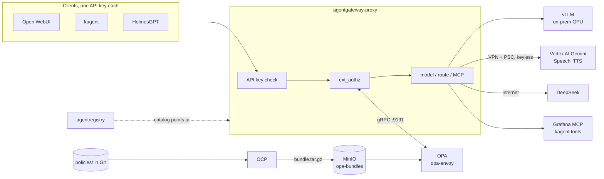

# Model and tool gateway: agentgateway, OPA, OCP, agentregistry

Every model call and every shared MCP tool call on the platform goes through one
gateway, [agentgateway](https://agentgateway.dev). Before routing a request, the
gateway asks OPA whether this client may use this model or tool. OPA's policy is
Rego in this repo; the OPA Control Plane (OCP) builds it into a bundle and OPA
loads it. agentregistry is the catalog where people find the tools.

agentgateway replaces LiteLLM, which this platform used before.



## The pieces

| Piece | Argo CD app | What it does |
|-------|-------------|--------------|
| agentgateway controller | `agentgateway`, `agentgateway-crds` | Creates the GatewayClass `agentgateway`. For each Gateway, it runs a proxy Deployment, Service and ServiceAccount named after the Gateway |
| Gateway config | `agentgateway-config` (`minikube/gitops/agentgateway-config`) | The `agentgateway-proxy` Gateway, one `AgentgatewayModel` per model, passthrough routes to Google's APIs, the merged MCP endpoint, and policies for API keys, OPA and tracing |
| OPA | `opa-policy` (`minikube/gitops/opa-policy`) | `opa-envoy`, answering ext_authz over gRPC on `opa:9191` |
| OCP | `opa-policy` | Builds `policies/<bundle>` from this repo's `main` branch on GitHub into `opa-bundles/<bundle>/bundle.tar.gz` in MinIO |
| agentregistry | `agentregistry`, `agentregistry-postgresql`, `agentregistry-catalog` | The catalog of MCP servers (and later agents), at `agentregistry.test` behind the Keycloak login. Its entries live in `minikube/gitops/agentregistry-catalog/files/catalog.yaml` |

Endpoints inside the cluster:

- Models: `http://agentgateway-proxy.mini-platform.svc.cluster.local/v1` (OpenAI API:
  `/chat/completions`, `/models`, `/responses`, `/messages`, `/embeddings`).
- Tools (MCP, streamable HTTP): `http://agentgateway-proxy.mini-platform.svc.cluster.local/mcp`.
- Google APIs: `http://agentgateway-proxy.mini-platform.svc.cluster.local/google/<api>/...`.

Outside the cluster, the same endpoints are at `http://agentgateway.test`.

## Models

| Model | Where | Placement |
|-------|-------|-----------|
| `qwen3.6-27b` | vLLM on the local GPU | `onprem` |
| `gemini-4-argon`, `gemini-3.8-flash`, `gemini-3.5-flash`, `gemini-3.5-flash-lite` | Vertex AI `eu`, through `aiplatform.eu.rep.googleapis.com` and the VPN | `gcp` |
| `deepseek-v4-pro` | `api.deepseek.com` over the internet | `external` |

The names are the ones LiteLLM used, so no client had to rename a model.

Every model and Google API is declared once, in the model catalog
[`catalog/models.yaml`](../catalog/models.yaml), with its placement and provider
settings. `scripts/gen-catalog.py` validates the catalog and generates two files
from it:

- `minikube/gitops/agentgateway-config/files/catalog.json`, which the gateway
  chart turns into `AgentgatewayModel` objects and Google API routes.
- `policies/gateway/catalog/data.json`, which OPA reads as `data.catalog` for
  placements.

A model therefore can't be routed without a placement, or allowed without a
route.

To add a model or a Google API:

1. Add it to `catalog/models.yaml`.
2. Run `python3 scripts/gen-catalog.py` and commit the generated files with it.
   CI (`validate-gitops.sh`) fails if they are out of date.

The policy change goes live when OCP rebuilds the bundle from `main`. The
gateway change goes live on the next Argo CD sync.

### Google login without a key

The proxy runs as the ServiceAccount `agentgateway-proxy`. Its projected token is
exchanged for a Google token through the `onprem-k8s` workload identity pool,
then impersonates `litellm-stt` (`GOOGLE_APPLICATION_CREDENTIALS`, set by
`AgentgatewayParameters`). Google accepts only the subjects listed in
mini-cloud's `infra/modules/gcp-stt-poc` `k8s_subjects`. Renaming the Gateway
breaks this until that list is updated.

### Speech and other Google APIs

agentgateway doesn't translate OpenAI `/v1/audio` calls into Speech or TTS
calls the way LiteLLM did. Instead, clients call Google's own APIs through the
gateway, which adds the Google token:

| Route | Google API |
|-------|------------|
| `/google/speech/...` | Speech-to-Text v2, Chirp 3, `eu-speech.googleapis.com` |
| `/google/tts/...` | Text-to-Speech, Chirp 3 HD voices, `eu-texttospeech.googleapis.com` |
| `/google/vertex-eu/...` | Vertex AI `eu`, for Gemini TTS through `generateContent` |
| `/google/vertex-europe-west1/...` | Vertex AI `europe-west1`, for the Gemini Live websocket |

For example, a TTS call:

```bash
curl -s http://agentgateway.test/google/tts/v1/text:synthesize \
  -H "Authorization: Bearer $KEY" -H 'content-type: application/json' \
  -d '{"input":{"text":"Bonjour"},"voice":{"languageCode":"fr-FR","name":"fr-FR-Chirp3-HD-Aoede"},"audioConfig":{"audioEncoding":"MP3"}}'
```

## Projects and keys

Every API key belongs to a **project**. Each project is one file,
`projects/<id>.yaml`, checked against [`projects/schema.json`](../projects/schema.json):

```yaml
project: holmes
owner: platform team
data_class: internal            # caps placement (see below)
placement: [onprem]             # optional; may only narrow the class
models:
  allow: ["gemini-3.5-*"]       # optional, default ["*"]; globs over catalog names
keys: [holmes, holmes-2]        # key ids; the secrets are in Vault
mcp_tools: ["grafana_*"]        # optional; no MCP access without it
```

`scripts/gen-projects.py` validates the files, including rules across files:

- the file name is the project id
- placement stays within the data class
- every `models.allow` pattern matches a catalog model
- key ids are `<project>` or `<project>-<suffix>`, and unique

It then generates `policies/gateway/projects/data.json` (`data.projects`) and
`policies/gateway/exceptions/data.json` (`data.exceptions`). CI fails if they
are out of date.

Today's projects are the four former clients, each with one key whose id is the
project id:

| Project | Data class | Mirror (env name the client reads) |
|---------|------------|------------------------------------|
| `open-webui` | `internal` | `open-webui-agentgateway` |
| `kagent` | `internal`, plus the DeepSeek exception | `kagent-agentgateway` |
| `holmes` | `internal`, plus the DeepSeek exception | `holmes-agentgateway` |
| `admin` | `public` | none: for people |

Keys are created by `scripts/bootstrap-vault-secrets.sh`, which reads the key
ids with `gen-projects.py --keys`, so it needs python3 with PyYAML and
jsonschema:

- `mini-platform/agentgateway-api-keys` is what the gateway reads: one entry per
  key id, `{"key": ..., "metadata": {"project": ..., "key_id": ...}}`.
- `mini-platform/agentgateway-client-keys` holds the raw keys under the same
  ids.

To add a project, write its file and run `python3 scripts/gen-projects.py`.
Then merge, and run the bootstrap with `SEED_MISSING_ONLY=true` to create its
keys.

To rotate a key:

1. Add a second id, such as `holmes-2`, and create it with the bootstrap.
2. Move the client to the new key.
3. Remove the old id from the project file. OPA refuses the old key as soon as
   the new bundle is live (`key holmes is not active for project holmes`). The
   next bootstrap run drops it from Vault.

## Policy

`policies/gateway/authz.rego` decides each request from:

- `data.projects` and `data.exceptions`, generated from `projects/`
- `data.catalog`, generated from `catalog/models.yaml`
- `data.gateway.classes` in `policies/gateway/data.json`, which maps each data
  class to the placements it may use

The rules:

- **Data classes,** as in mini-cloud's `docs/gcp/ai-inference.md`:
  - `restricted` and `confidential`: `onprem` only
  - `internal`: `onprem` and `gcp`
  - `public`: also `external`

  A project may use a model if the model's placement is in the project's
  placement (capped by its class) and the name matches `models.allow`.
- **Exceptions** (`projects/_exceptions.yaml`, owned by the platform team). A
  project can get named models outside its class, each with an owner and a
  reason. Today kagent and Holmes have one for DeepSeek.
- **Keys.** The key's id must be listed in its project's file.
- **Google APIs.** Allowed when the API's placement (`gcp`) is in the project's
  placement.
- **MCP.** A project with `mcp_tools` may open sessions and list tools. Each
  `tools/call` must name a tool that matches one of its patterns, such as
  `grafana_*`. Tool names carry the target's prefix: `grafana_...` or
  `kagent-tools_...`.
- **Everything else** is denied, with a 403 whose body gives the reason:
  ```json
  {"error":{"message":"model deepseek-v4-pro is not allowed for project open-webui (internal data)","type":"policy_denied"}}
  ```

### Changing a policy

1. Edit the Rego, the data or a project file, regenerate with
   `scripts/gen-projects.py`, and run `opa test policies/gateway`. CI runs the
   generators' `--check`, `opa check`, `opa fmt` and `opa test` too
   (`scripts/validate-gitops.sh`).
2. Merge to `main`. OCP checks Git about every 30–60 seconds and publishes a new
   bundle. OPA checks MinIO every 10–30 seconds and loads it. No Argo CD sync is
   involved.
3. Check the bundle with `kubectl -n mini-platform port-forward deploy/opa
   8181` and `curl localhost:8181/v1/data/system/bundles`. The manifest names
   the Git commit it was built from.

OPA logs every decision to stdout, and Loki collects them. Request bodies and
the `authorization` header are masked (`policies/gateway/log_mask.rego`).

The gateway fails closed: if OPA is down, every request is denied.

## MCP and agentregistry

The gateway merges Grafana MCP and kagent's tool server into one MCP endpoint at
`/mcp`. It sets `Host` to the target's Service name and does not forward the
client's API key to the target. For that reason, `kagent-values.yaml` adds the
port-less Service name to Grafana MCP's `--allowed-hosts`.

Holmes' GitHub MCP server stays direct: it reads its GitHub token from the
`Authorization` header, which is the header the gateway's API key uses.

kagent's own agents still use their `RemoteMCPServer` entries directly. The chart
generates those, with no way to add the gateway key.

agentregistry lists `platform-tools`, the gateway's MCP endpoint. agentregistry
v0.4.0 accepts only Bedrock models, so models are not in it; `GET /v1/models` on
the gateway is the model list.

To add an entry, edit `minikube/gitops/agentregistry-catalog/files/catalog.yaml`.
A PostSync Job posts it to `/v0/apply` and fails the sync if any entry is
rejected.

## Telemetry

- **Metrics.** Prometheus finds the proxy, the controller and OPA through their
  `prometheus.io` pod annotations. The proxy's main metrics are
  `agentgateway_gen_ai_client_token_usage`, `agentgateway_gen_ai_client_cost_usd_total`,
  `agentgateway_gen_ai_server_time_to_first_token` and
  `agentgateway_requests_total`. The upstream dashboard is in Grafana as
  **Agentgateway**.
- **Traces.** OTLP goes to Alloy, then to Tempo, under service name
  `agentgateway-proxy`. Langfuse gets the clients' own traces (kagent, Holmes,
  Open WebUI projects), not a per-call gateway project like LiteLLM's.

## Checks

```bash
KEY=$(vault kv get -field=admin mini-platform/agentgateway-client-keys)
curl -s http://agentgateway.test/v1/models -H "Authorization: Bearer $KEY" | jq -r '.data[].id'
curl -s http://agentgateway.test/v1/chat/completions -H "Authorization: Bearer $KEY" \
  -H 'content-type: application/json' \
  -d '{"model":"gemini-3.5-flash-lite","messages":[{"role":"user","content":"hi"}]}'
```

| Check | Expected |
|-------|----------|
| No key | 401 |
| Open WebUI key, `deepseek-v4-pro` | 403, `not allowed for internal data` |
| Holmes key, `tools/call` of `kagent-tools_*` | 403, `tool ... is not allowed for holmes` |
| `curl opa:8181/v1/data/system/bundles` | Manifest with the latest `main` commit |

## Limits

- **Local rate limits only.** Token and request limits are per proxy replica.
  A shared limit needs a global rate-limit service.
- **Model list not filtered.** `/v1/models` lists every model to every client.
  OPA only refuses the call.
- **No MCP auth to the targets.** The targets trust the network.
  NetworkPolicy, on a CNI that enforces it, should allow only the proxy to reach
  them.
- **Gemini Live websocket.** Routed as plain passthrough. Not tested yet.
