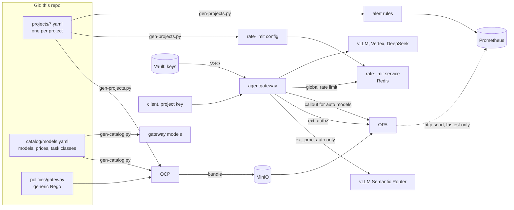

# Design: per-project model policy at scale

Status: **built and deployed** (2026-11-10, PRs #24–#38, #42, #44 and #45, and mini-platform#24).
This is the design record: what was decided, what changed while building it,
and the spike evidence behind each choice. To operate it (adding a project,
rotating a key, changing a limit), use [agentgateway.md](agentgateway.md).

The target is about **200 projects, each with several API keys**. Each project
gets its own model policy:

- on-prem only, cloud only, or both
- a narrowed model list or a single model
- routing for `model: "auto"`: cheapest, fastest, by prompt type, or fixed
- request, token and spend limits, and MCP tools

## The rule: keys say who, data says what

A key identifies a project and nothing more: its metadata is
`{"project": ..., "key_id": ...}`. Every rule is data about the project, read by
one generic Rego policy. Nobody writes Rego for a project, and adding a project
or a model is a data change.



## What was built

| Step | What | PR |
|------|------|----|
| 1 | **Model catalog** `catalog/models.yaml`: every model and Google API once, with placement, provider settings, price and task classes. `gen-catalog.py` generates the gateway's models and the policy's `data.catalog` | #24 |
| 2 | **Projects** `projects/<id>.yaml`, checked against `projects/schema.json` and cross-file rules by `gen-projects.py`. Keys carry `{project, key_id}`; a key not listed by its project is refused | #25, #26 |
| 3 | **Selection** `select.rego`, sharing `lib.allowed` with authorization | #27 |
| 4 | **`auto` virtual models**: callout to OPA for `auto` and `auto-<task>` | #28 |
| 5 | **vLLM Semantic Router** rewrites `auto` to a task class | #29, mini-platform#24 |
| 6 | **`project` metric label** and the "Agentgateway projects" dashboard | #30, #31 |
| 7 | **Latency rankings** for `fastest`, read from Prometheus | #32 |
| 8 | **Rate limits and spend caps** in a global rate-limit service | #33 |
| 9 | **Limits and budgets for every project**; Open WebUI on `semantic` | #34 |
| 10 | **`/v1/models` per project**: OPA names the allowed models, a response transformation filters the gateway's list | #35 |
| 11 | **Alerts**: budget forecast, project rate-limited, provider throttling, generated from the projects; promtool in CI | #36, #37, #38 |
| 12 | **Two bundles** (`gateway-policy`, `gateway-projects` with one file per project); the rate limiter refuses unknown projects; decision log keeps the model; `policy-replay.py` | #42 |
| 13 | **Agents** `agents/<id>.yaml`: per-agent keys narrowing their project's models and tools; kagent's agents on their own ModelConfigs; published in agentregistry | #44 |
| 14 | **Tool risk**: `catalog/tools.yaml` classes every MCP tool read, write or irreversible; OPA holds agents to their autonomy; unknown tools count as irreversible; `tools-drift.py` | #45 |

## Decisions

### Rules are about model attributes, not names

"On-prem only" means `catalog[m].placement in project.placement`. A new on-prem
model therefore needs no change to 200 files. A project's allowed set
(`lib.rego`) is:

```
allowed(p) = { m in catalog
             | placement(m) ∈ placement(p) ∩ class_placements(data_class(p))
             ∧ m matches models.allow(p) }
             ∪ exceptions(p)
```

- **The data class caps placement,** even if the generated data says otherwise.
- **Exceptions** live in `projects/_exceptions.yaml`, owned by the platform
  team, not in the project's own file.
- **Model patterns use `glob.match(pattern, null, m)`.** With `[]` as the
  delimiters OPA defaults to `.`, and `*` would not match the dot in
  `qwen3.6-27b`. The `null` matches `fnmatch` in the generator.

OCP does not limit which data paths a source may write. It checks Rego package
overlaps only. That is why teams write YAML that CI validates, never Rego.

### Selection never widens authorization

Authorization (`authz.rego`) and selection (`select.rego`) use the same
`lib.allowed`. A property test checks that the selection is either nothing or
one of `lib.allowed(project)`. It runs for every project, under four narrowings
that rule out the overall cheapest or fastest model, every routing rule and every
task, with Prometheus up or down.

The first version of that test passed even when selection ranked every catalog
model. The cheapest model, on-prem Qwen, was allowed for every project, so the
leak never showed. The narrowings were added for that reason. Three deliberate
leaks now each fail it: an unfiltered fastest ranking, unfiltered task
preferences, and an unchecked fixed model.

### `auto`: VSR names the task, OPA picks the model

VSR has no per-project allowlist, so it must never pick the concrete model: it
could send an on-prem-only project to Gemini. Each component answers one
question:

1. **VSR, what kind of request is this?** It runs as an ext_proc filter in the
   gateway's `PreRouting` phase, only for `/v1/chat/completions` with
   `model: "auto"`. It rewrites `auto` to `auto-code`, `auto-reasoning` or
   `auto-general`.
2. **OPA, which model may this project use for it?** Each `auto*` name is an
   `AgentgatewayModel` virtual model. Its `callout` posts `{project, task}` to
   `/v1/data/gateway/select/result`, and the gateway routes to the answer.

Rejected:
- **VSR's own agentgateway setup,** where VSR picks the model and OPA refuses
  afterwards. Users would get 403 whenever VSR's favourite isn't allowed.
- **OPA calling VSR's routing preview API.** VSR binds its management API to
  `127.0.0.1` unless bearer auth is configured, and the prompt would end up in
  OPA's input and decision log.

Failure behaviour:
- **VSR down:** the ext_proc filter fails open. The request goes on as `auto`,
  and the project gets its default.
- **OPA has no answer:** 503. There is no fallback model, because a fallback
  would also serve projects OPA doesn't know.

The gateway's ext_authz check sees `auto`, not the model behind it. That is safe
only because selection is a subset of authorization.

### No selection cache

The first version of the `auto` models cached OPA's answer for a minute per
project. Codex review on #28 found the hole. A cache hit skips OPA, and
ext_authz only sees `auto`. After a policy change revoked the cached model, for
example kagent's DeepSeek exception, the gateway would keep routing to it until
the entry expired. The cache is now off by default (`auto.cacheTTL: ""`). The
callout costs about a millisecond.

### Routing rules

| `routing` | Order |
|-----------|-------|
| `cheapest` (default) | blended price `(3 × input + output) / 4` |
| `fastest` | median model request duration, then price |
| `semantic` | the task class's list in the catalog, then cheapest |
| `fixed:<model>` | that model, then cheapest |

**Prices** come from agentgateway v1.7.0's built-in price table, the same
rates behind its cost metrics. Each one was checked against
`agentgateway_gen_ai_client_cost_usd_total`. For example, Gemini 4 Argon: 136
input × $2 + 24 output × $10 per million tokens = $0.000512, exactly what the
metric recorded. DeepSeek is billed at $0.66 / $1.98. On-prem Qwen costs $0.

### Rankings at decision time, not in the bundle

The design proposed an OCP `http` data source that pulls the rankings into the
policy bundle. The spike (below) showed OCP fails the **whole** bundle build
while a data source is unreachable. A Prometheus outage would then block every
policy change, key revocations included.

A separate rankings bundle doesn't work either. OPA's readiness probe is
`/health?bundles`, so a missing rankings bundle would leave OPA unready, and the
fail-closed gateway would refuse everything.

So `rankings.rego` asks Prometheus through `http.send`, for `fastest` projects
only:
- a 300 ms timeout, with errors ignored
- a 2-minute inter-query cache
- the signal is median request duration over 6 hours, at least 3 requests,
  scoped to the production gateway

There is no time-to-first-token metric without streaming traffic. Failed calls
count too, so a throttled model ranks as slow. If Prometheus is down, `fastest`
is `cheapest`. Authorization never reads it.

### Limits and budgets outside OPA

Limits and budgets are counters, not policy, so they live in a global rate-limit
service (`envoyproxy/ratelimit`, with Redis), not in OPA. `gen-projects.py`
generates its config from the projects' `limits` and `budget`. The gateway
sends three descriptors per request:

| Descriptor | Unit | Counted |
|------------|------|---------|
| `requests` | Requests | before the call |
| `tokens` | Tokens | when the call completes |
| `budget_micro_usd` | Tokens, cost `int(llm.cost.total * 1e6)` | when the call completes |

- **When counts happen:** tokens and cost are known only after a call, so the
  call that crosses a limit finishes and the next one gets 429.
- **The budget window:** the service's "month" is a fixed 30-day window counted
  from the Unix epoch, not a calendar month. Hence the field is called
  `budget.usd_per_30_days`.
- **The ConfigMap symlink:** the service needs `RUNTIME_IGNOREDOTFILES=true`.
  Otherwise it reads the ConfigMap's file a second time through `..data` and
  rejects the "duplicate domain".
- **Failure:** the policy fails open, because these are cost control and OPA
  still decides access.

### Reporting

- **Metrics:** every gateway metric carries a `project` label from the key's
  metadata. Requests without a valid key get `unknown`. Key ids stay out of
  labels, to keep cardinality low; they are in OPA's decision log.
- **Dashboard:** "Agentgateway projects" shows per project:
  - requests, refusals, tokens and cost
  - a cost table by project and model
  - the model mix, which shows what `auto` picked
  - latency and MCP calls

### The model list from OPA, filtered in the gateway

agentgateway answers `/v1/models` itself, and a model's `visibility` is global,
so it can't hide a model from one project. For that path OPA's allow decision
adds an `x-allowed-models` request header, `lib.allowed(project)` plus the
`auto` names, and a response transformation keeps only those entries. One
source of truth, the same set authorization uses; a test checks that every
listed model is callable. OPA's header replaces any the client sends, and
without it the list goes out whole: the list is cosmetic.

### Alerts generated with the limits

`gen-projects.py` also writes Prometheus alert rules, so thresholds follow the
budgets. The budget forecast takes the last 24 hours × 30 against 80% of the
budget: Prometheus keeps 15 days, so the 30-day count isn't there. `429`s
separate on the `reason` label: `RateLimit` is the project's own limit or
budget, `Upstream` the provider's throttling.

### Two bundles: policy and project data

Size is not the reason. A project is about 400 bytes of data and OPA looks a
project up by id, so 1,000 projects are under half a megabyte and decide as
fast as four. The reasons are change and blast radius:

- **`gateway-policy`** (`policies/gateway`) holds the Rego, the data classes and the catalog. It changes
  rarely, and a mistake there affects every project.
- **`gateway-projects`** holds one `data.json` per project and per exception.
  It changes with every project request, and a change touches only its own
  file, so pull requests for different projects never conflict.

Each bundle's `.manifest` declares its roots, and the roots are disjoint, so
OPA activates each bundle on its own. OCP stacks, which add mandatory sources
by label, only matter once separate OPA fleets need different policy.

### A project the rate-limit service doesn't know is refused

OPA learns about a project from Git within a minute or two, but the rate-limit
service only after an Argo CD sync of `rate-limit`. In between, the service
used to have no entry for the project and let every call through: no request
limit, no budget. Its config now ends in a default entry, matched by any project
not listed, whose request limit is 0, so such calls get 429 until the sync.
Every listed project has an entry for each kind, with `unlimited: true` where
the project sets no limit.

## How long changes take

| Change | Path | Delay |
|--------|------|-------|
| Project change | merge → OCP rebuilds `gateway-projects` only (30–60 s) → OPA poll (10–30 s) | 1–2 min |
| Catalog or Rego change | merge → OCP rebuilds `gateway-policy` (30–60 s) → OPA poll (10–30 s) | 1–2 min |
| Revoke a key | drop its id from the project file | the same |
| Remove a key from Vault | bootstrap → VSO refresh → gateway reload | VSO interval (1 min) |
| New model routes or `auto` models | merge → Argo CD sync of `agentgateway-config` | sync |
| Limits and budgets | merge → Argo CD sync of `rate-limit` (pod restart) | sync; a new project gets 429 until then |
| Alert thresholds | merge → Argo CD sync of `prometheus` (config reload) | sync |
| Rankings | Prometheus → OPA cache | ≤ 2 min |

## Rollouts that needed care

- **Key metadata `{client}` → `{project, key_id}`** (#25, #26). The policy, the
  gateway config and the keys in Vault update at different times, and the
  gateway fails closed. Both formats were accepted during the switch: CEL
  `default(apiKey.project, apiKey.client)` and a policy fallback. That was
  checked first on a throwaway gateway. The fallback was removed once Vault held
  only new-style keys, whose values were unchanged (same SHA-256 fingerprints).
- **Argo CD's root app pins its own source revision** separately from the child
  apps' `deployRevision`. A new app in the app-of-apps list (VSR, rate-limit)
  only appears after the root's own `targetRevision` moves.
- **Prometheus rule paths** (#36, #37). `rule_files` took
  `/etc/alerts.d/*/*.yml`; Prometheus allows a glob only in the last path
  segment and crash-looped, about 15 minutes without metrics (the Deployment is
  `Recreate`). The rules file had passed `promtool check rules`, but the
  config had never been checked. CI now renders `prometheus.yml` and runs
  `promtool check config` on it (#38).
- **Defaulted fields cause drift.** The API server fills in `group` and `kind`
  on `backendRef`s. Templates spell them out, or Argo CD reports the object
  OutOfSync forever (#31).

## Spikes

All spikes ran on throwaway gateways in `mini-platform`, named `spike-…` and
deleted afterwards. One early spike reused real model object names, and
`kubectl apply` overwrote two production `AgentgatewayModel`s; Argo CD's
self-heal restored them within seconds. After that, every spike object got the
`spike-` prefix and was checked for collisions before applying.

### 1. OPA callout (agentgateway 1.7.0, OPA 1.22.2)

| Check | Result |
|-------|--------|
| `auto`, cheapest / fastest / on-prem only | 200, the expected model each time |
| `Internal` concrete model requested directly | 404 |
| Unknown project, or OPA down without a fallback | 503 `virtual_model_callout_failed` |
| What ext_authz sees | `auto` (it runs before the callout) |
| `project` metric label | present on requests and token metrics |

### 2. VSR for `auto` (VSR 0.4.0, CPU)

| Prompt | all placements | on-prem + GCP | on-prem only |
|--------|----------------|---------------|--------------|
| code | `deepseek-v4-pro` | `gemini-3.8-flash` | `qwen3.6-27b` |
| reasoning | `gemini-4-argon` | `gemini-4-argon` | `qwen3.6-27b` |
| general | `gemini-3.5-flash-lite` | `gemini-3.5-flash-lite` | `qwen3.6-27b` |

With VSR down, every project got its cheapest allowed model. VSR adds about
40 ms and uses about 3 GiB of memory. It keeps 3.6 GB of classifier models on a
PVC and starts in 42 s with them cached.

### 3. Rankings through OCP (OCP 0.10, local Docker)

An `http` data source with a `transform_query` built `data.rankings` and rebuilt
on `rebuild_interval`. **With Prometheus unreachable, the whole bundle failed to
build.** Bundle roots follow the layout: a top-level `data.json` makes the roots
`[""]`. This led to the decision-time design above.

### 4. Rate limits (envoyproxy/ratelimit 5ae0682e, real DeepSeek calls)

| Check | Result |
|-------|--------|
| 3 requests/minute | 200 ×3, then 429 |
| 200 tokens a month (about 90 per call) | 200 ×3, then 429 |
| cost `llm.cost` | never charged: `llm.cost` is an object; the USD total is `llm.cost.total` |
| budget of 20 µUSD | first call charged 66 µUSD, then 429 |
| service down | everything passed (fail-open) |
| `month` window | started 2026-11-03: a 30-day epoch window |

## Verified on the cluster

- Per-project allow/deny through the real gateway, including OPA's reasons
  ("model deepseek-v4-pro is not allowed for project open-webui (internal
  data)") and revocation of an unlisted key id.
- `auto` with every project, and VSR-driven routing for `admin`:
  - code → DeepSeek
  - small talk → Gemini Flash Lite
  - reasoning → Gemini 4 Argon (Vertex returned 429)
- Admin's limit: 60 × 200, then 429 with `retry-after`. The budget counter in
  Redis was charged 5 µUSD for one Flash Lite call.
- Holmes' limit: 35 requests at once, 30 × 200 and 5 × 429. Open WebUI's `auto`
  went to Gemini Flash Lite for a general question (`semantic`).
- `/v1/models`: 9 models for Open WebUI (no DeepSeek), 10 for kagent and Holmes,
  metadata kept; a spoofed `x-allowed-models` changed nothing.
- Alert rules: 6 loaded and healthy.

## Open

- **Routing for kagent and Holmes.** They are on `cheapest`. `semantic` or
  `fastest` sends their `auto` traffic to paid models, now capped by their
  budgets. Every project has limits and a budget (`docs/agentgateway.md`).
- **Vertex quota.** Gemini 4 Argon and 3.8 Flash return 429
  `RESOURCE_EXHAUSTED` under light load, which needs a quota check for
  `mini-cloud-499820` in `eu`.
- **Time to first token** needs streaming traffic before `fastest` can use it.
- **A key service:** keys are created by the bootstrap script. Self-service key
  issue and rotation for 200 projects needs a small service or portal that
  writes to Git and Vault.
