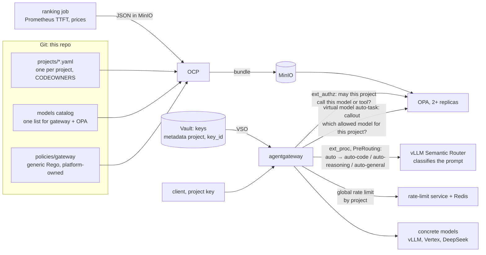
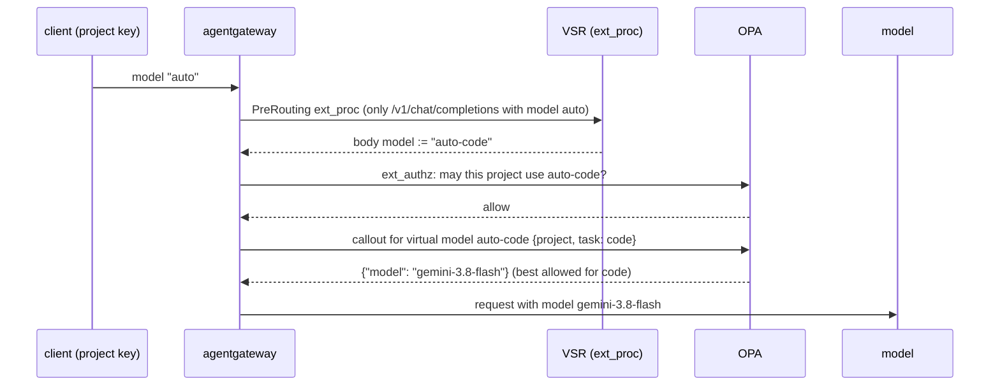

# Design: per-project model policy at scale

Status: **design, with two spikes** (2026-11-10). Nothing in this doc is deployed
yet. Today's gateway ([agentgateway.md](agentgateway.md)) has four clients, one
key each, and a data class per client.

This doc covers the next step: about **200 projects, each with several API
keys**. Each project gets its own model policy:

- on-prem only, cloud only, or both
- a single model
- "give me the cheapest" or "give me the fastest"
- token budgets and MCP tools

## The rule: keys say who, data says what

A key identifies a project and nothing more. Every rule is data about the
project, read by one generic Rego policy. Nobody writes Rego for a project, and
adding a project or a model is a data change.



## Parts

| Part | Holds | Lives in | Owner |
|------|-------|----------|-------|
| **Project files** | One file per project: owner, data class, placement, models, routing, budget, MCP tools | `projects/<id>.yaml` in this repo. Each team owns its file through CODEOWNERS. Git is enough for 200 projects; a self-service portal, if one comes later, writes to Git instead of replacing it | The project's team |
| **Exceptions** | Anything beyond what the project's data class allows, each with an owner and a reason | `projects/_exceptions.yaml` | Platform team |
| **Model catalog** | One entry per model: placement, provider, price per million input and output tokens, capabilities, visibility | One file that generates both the `models` values of `agentgateway-config` and the `models` data for OPA. Today these are two lists that can drift | Platform team |
| **API keys** | Several keys per project, so a key can be rotated with no gap. Metadata is `{"project": ..., "key_id": ...}` only. Policy never goes in the key | Vault, mirrored by VSO into the gateway's key Secret. About 1,000 keys at roughly 150 bytes each is far below the 1 MiB Secret limit. `secretSelector` can also split them across Secrets | Bootstrap script now, a key service later |
| **Generic policy** | `authz`: may the project use this model, Google API or tool? `select`: which model `auto` means | `policies/gateway/*.rego` | Platform team |
| **OPA** | The bundle | At least 2 replicas and a PodDisruptionBudget. The gateway fails closed, so OPA's availability is the gateway's | Platform team |
| **OCP** | Builds one bundle from the sources | `opa-policy` chart | Platform team |
| **vLLM Semantic Router (VSR)** | Classifies each `auto` prompt into a task class (code, reasoning, general, ...). It does not choose the concrete model and knows nothing about projects | Chart `oci://ghcr.io/vllm-project/charts/semantic-router` 0.4.0, as the gateway's ext_proc filter. In the spike it used about 3 GiB of memory on CPU, kept 3.6 GB of classifier models on a PVC, and started in 42 s with the models already cached | Platform team |
| **Ranking job** | Per-model latency (p50 time to first token from `agentgateway_gen_ai_server_time_to_first_token`) and health | A CronJob writes JSON to MinIO. OCP pulls it as an `http` datasource when it builds the bundle | Platform team |
| **Rate limits and budgets** | Tokens per minute and a monthly spend cap per project | agentgateway's global (remote) rate limiting, with a rate-limit service and Redis, keyed by `project`. This is live state, so it does not go in an OPA bundle | Platform team |

### A project file

```yaml
project: payments
owner: team-payments
data_class: confidential          # caps placement; see "Guardrails"
placement: [onprem]               # onprem | gcp | external
models:
  allow: ["*"]                    # or ["qwen3.6-27b"] for a single model
routing: semantic                 # semantic (VSR) | cheapest | fastest | fixed:<model>
budget:
  tokens_per_minute: 50000
  usd_per_month: 200
mcp_tools: ["grafana_*"]
```

CI checks each file against a JSON Schema. One malformed file must not break
the bundle for all 200 projects. OPA keeps serving the last good bundle, but CI
is the place to catch it.

## Policy

### Rules are about model attributes, not model names

"On-prem only" means `catalog[m].placement in project.placement`. It does not
mean a list of on-prem models. When a new on-prem model joins the catalog,
every on-prem project can use it without anyone editing 200 files. A project
that wants a fixed set uses `models.allow`.

The set of models a project may use is:

```
allowed(p) = { m in catalog
             | placement(m) ∈ placement(p) ∩ class_placements(data_class(p))
             ∧ m matches models.allow(p) }
             ∪ exceptions(p)
```

### Guardrails

- **The data class caps placement.** A `restricted` project that lists `gcp` in
  `placement` still gets only on-prem models. The class table is the one in
  mini-cloud's `docs/gcp/ai-inference.md`, already in `policies/gateway/data.json`.
- **Exceptions live in a file the platform team owns,** not in the project's
  own file.
- **Default deny.** An unknown project, model or tool is refused with a 403
  that gives the reason, as today.

OCP does not limit which data paths a source may write. It rejects two sources
with overlapping Rego packages, but it does not stop one team's file from
writing another team's data. That is why project files are YAML checked by CI
against the schema and assembled by CI, never Rego written by the teams.

### Choosing the model: VSR finds the task class, OPA picks the model

A client that wants the platform to choose sends `"model": "auto"`. Two
questions need answering, and each component answers one:

- **What kind of request is this?** That depends on the prompt.
  **VSR** answers it with a task class.
- **Which model may this project use for that class?** That depends on the
  project. **OPA** answers it from the project data.

VSR has no per-project model allowlist, so it must not pick the concrete model.
If it did, it could send an on-prem-only project to Gemini. OPA never reads the
prompt.



1. **VSR rewrites `auto` to a task class.** It runs as an ext_proc filter in the
   gateway's `PreRouting` phase, with a CEL condition so that only
   `/v1/chat/completions` requests whose `model` is `auto` go to it. Its
   decisions point at the class names (`auto-code`, `auto-reasoning`,
   `auto-general`) rather than at real models. The gateway then routes on the
   rewritten `model`.
2. **Each class is a virtual model whose callout asks OPA.** The callout sends
   `{project, task}`. OPA walks the class's preference list, for example `code →
   [deepseek-v4-pro, gemini-3.8-flash, qwen3.6-27b]`, keeps only the models in
   `allowed(project)`, and returns the first. If none remains, it returns the
   project's cheapest allowed model.
3. **If VSR is down,** the ext_proc filter fails open. The request goes on with
   `model: "auto"`, a virtual model whose callout sends only the project, so OPA
   returns the project's default (cheapest allowed). The request still gets an
   answer.

```yaml
# ext_proc to VSR, in PreRouting so the rewritten model drives routing
apiVersion: agentgateway.dev/v1alpha1
kind: AgentgatewayPolicy
metadata:
  name: agentgateway-proxy-vsr
spec:
  targetRefs: [{group: gateway.networking.k8s.io, kind: Gateway, name: agentgateway-proxy}]
  traffic:
    phase: PreRouting
    extProc:
      conditional:
      - condition: 'request.path == "/v1/chat/completions" && json(request.body).model == "auto"'
        policy:
          backendRef: {name: semantic-router, port: 50051}
          failureMode: FailOpen
          processingOptions:
            requestHeaderMode: Send
            requestBodyMode: Buffered
            responseHeaderMode: Send
            responseBodyMode: None
            requestTrailerMode: Skip
            responseTrailerMode: Skip
---
# One per task class; the callout tells OPA the class
apiVersion: agentgateway.dev/v1alpha1
kind: AgentgatewayModel
metadata:
  name: auto-code
spec:
  parentRefs: [{group: gateway.networking.k8s.io, kind: Gateway, name: agentgateway-proxy, sectionName: http}]
  match: {model: auto-code}
  virtualModel:
    callout:
      backendRef: {name: opa, port: 8181}
      headers: {":path": '"/v1/data/gateway/select"', ":method": '"POST"', content-type: '"application/json"'}
      body: '{"input": {"project": apiKey.project, "task": "code"}}'
      transformation: {model: 'callout.body.result.model'}
      cache: {key: ['apiKey.project'], ttl: 1m}
```

VSR's side of the config: each decision points at a class name instead of a
real model:

```yaml
config:
  providers:
    defaults: {model: auto-general}
    models:
      - {name: auto-code, provider_model_id: auto-code, backend_refs: [{name: gateway, provider: vllm, endpoint: agentgateway-proxy.mini-platform.svc.cluster.local:80, weight: 1}]}
      # auto-reasoning, auto-general: the same
  routing:
    signals:
      domains:
        - {name: computer science, description: "Algorithms, data structures, programming, software engineering"}
        - {name: math, description: "Mathematics, algebra, calculus, geometry, statistics"}
        - {name: other, description: "General knowledge and miscellaneous topics"}
    decisions:
      - name: code
        priority: 20
        rules: {operator: OR, conditions: [{type: domain, name: computer science}]}
        modelRefs: [{model: auto-code, use_reasoning: false}]
      # reasoning (math, physics, "step by step"), general (other): the same
```

The `backend_refs` are required by VSR's schema but are not called. The
gateway, not VSR, sends the request on.

Other ways that were rejected:

- **VSR picks the concrete model, OPA's ext_authz denies what isn't allowed.**
  This is VSR's documented agentgateway setup. It fails the request with 403
  whenever VSR's favourite isn't allowed for the project. Selection has to be
  limited to allowed models; refusing afterwards is not enough.
- **OPA calls VSR's routing preview API (`/api/v1/routing/preview`) with
  `http.send`.** VSR binds its management API to `127.0.0.1`, unless
  `management_api.remote_exposure` is turned on with bearer auth. It would also
  put the prompt in OPA's input and decision logs.

### Choosing without VSR: `cheapest`, `fastest`, `fixed`

A project whose `routing` is not `semantic` still sends `auto`, through the same
virtual-model callout. OPA ignores the task class and picks by the project's
rule:

```yaml
apiVersion: agentgateway.dev/v1alpha1
kind: AgentgatewayModel
metadata:
  name: auto
spec:
  parentRefs: [{group: gateway.networking.k8s.io, kind: Gateway, name: agentgateway-proxy, sectionName: http}]
  match: {model: auto}
  virtualModel:
    callout:
      backendRef: {name: opa, port: 8181}
      headers:
        ":path": '"/v1/data/gateway/select"'
        ":method": '"POST"'
        content-type: '"application/json"'
      body: '{"input": {"project": apiKey.project}}'
      transformation:
        model: 'callout.body.result.model'
      cache:
        key: ['apiKey.project']
        ttl: 1m
      # No fallback, so a failed callout returns 503. A fallback would also
      # serve projects OPA doesn't know. If one is added, make it the most
      # restricted model (on-prem).
```

The selection rule uses the same `allowed(p)` set as authorization, so it can
only pick a model the project may use:

```rego
# Preference list: the task class's list when VSR supplied one (semantic
# projects), then the project's own rule. Only allowed models survive.
candidates := array.concat(
	object.get(data.task_prefs, object.get(input, "task", ""), []),
	ranked_by_project_rule, # cheapest | fastest | fixed:<model>
)

select := {"model": [m | some m in candidates; m in allowed(project)][0]}
```

Read `input.task` with `object.get`. When the plain `auto` callout sends no
`task`, a bare `input.task` is undefined, and Rego then makes all of `select`
undefined. The callout fails with 503 instead of falling back; the spike hit
exactly this. Add a unit test for a request with no task.

There is also a choice of which mechanism makes the pick:

- **Fastest at this moment.** `failover` virtual models are the better fit.
  Targets at the same priority are picked by a health and latency score that
  the gateway itself measures. Use them for a group such as "fast on-prem
  models". OPA's choice is better for "fastest by policy", based on
  minutes-old rankings.
- **Simple per-project rules.** `conditional` virtual models pick by CEL, for
  example `apiKey.project == "x"`. They need no OPA, but every rule lives in
  gateway YAML. That doesn't scale to 200 projects.

### Authorization still runs, on `auto`

The gateway's ext_authz call runs before the virtual model is resolved, so OPA
sees `model: "auto"` (spike 1, below). With VSR, it should see the rewritten
`auto-<task>`, because ext_authz runs in `PostRouting`, after VSR's
`PreRouting` rewrite. That follows from the documented filter order but wasn't
tested. `authz.rego` therefore allows `auto` and the `auto-*` classes for any
project whose `allowed` set is not empty. The concrete model is then whatever
`select` returned.

Virtual models must have `visibility: Public` (the CRD rejects anything
else), so a client can also ask for `auto-code` directly. That gets around
VSR's classification only. OPA still picks from the project's allowed models.

Both rules come from the same bundle and the same `allowed` set, so the pair
holds by construction. A unit test checks it for every project:
`select(p) in allowed(p)`.

Concrete models that should only be reached through `auto` get
`visibility: Internal`. A direct request for one returns 404.

## OCP

- **One bundle,** `gateway`, for the gateway's OPA. 200 projects is a few
  hundred kilobytes of data. Separate bundles only make sense when separate
  OPA fleets need different policy.
- **Sources** listed as `requirements` of the bundle:
  - the Rego, from Git at `policies/gateway`
  - the project and exception data, generated by CI from `projects/`, from Git
  - the rankings: an `http` datasource reading MinIO, fetched at build time.
    `rebuild_interval` on the bundle sets how stale they can get.
- **Stacks** add mandatory sources, such as org-wide guardrails, to every
  bundle whose labels match. With one bundle that is the same as a
  requirement. Stacks start to matter once there is more than one bundle, for
  example per environment.

## How long changes take

| Change | Path | Delay |
|--------|------|-------|
| Project or policy change | merge → OCP rebuild (30–60 s) → OPA polls (10–30 s), then up to the 1-minute callout cache for `auto` | about 1–3 min |
| Revoke a key quickly | add its `key_id` to `data.revoked_keys`, which authz checks | same as above |
| Remove a key | Vault → VSO refresh → gateway reload | VSO refresh interval |
| Rankings | CronJob → MinIO → next OCP rebuild | job interval + rebuild interval |

## Reporting

- **Metrics.** `frontend.metrics.attributes.add` on the Gateway adds
  `project` (from `apiKey.project`) as a label on every metric, token usage and
  cost included. That's enough for chargeback, a dashboard per project and
  budget alerts. 200 projects × a handful of models is an acceptable number of
  label combinations. `key_id` must not be a metric label; it goes in logs.
- **Decision logs.** OPA's decision logs in Loki carry `project`, `key_id`, the
  requested model and the reason.

## Spike 2: VSR for `auto` (2026-11-10, VSR 0.4.0)

This spike used the same kind of setup as spike 1. It added VSR from chart 0.4.0
on CPU, with three decisions: `code`, `reasoning` and `general`. It also had
five mock models named after the real ones, three projects, and the policies
above. Everything was deleted afterwards.

| Prompt | Project allows all | Project allows on-prem + GCP | Project allows on-prem only |
|--------|--------------------|------------------------------|-----------------------------|
| "Write a Python function that merges two sorted lists" (VSR: `code`) | `deepseek-v4-pro` | `gemini-3.8-flash` | `qwen3.6-27b` |
| "Prove that the square root of 2 is irrational" (VSR: `reasoning`) | `gemini-4-argon` | `gemini-4-argon` | `qwen3.6-27b` |
| "What is a good name for a cat?" (VSR: `general`) | `gemini-3.5-flash-lite` | `gemini-3.5-flash-lite` | `qwen3.6-27b` |

| Check | Result |
|-------|--------|
| VSR down (ext_proc `FailOpen`) | **200** for every project, from its cheapest allowed model |
| Client asks for `auto-reasoning` directly | **200**, still limited to the project's allowed models |
| Added latency | About 40 ms for VSR on CPU. Requests took 45–65 ms through VSR, against 5–10 ms without it, with mock models |
| Response headers | VSR adds `x-vsr-selected-decision`, `x-vsr-selected-confidence` and others. Strip them, or keep them for debugging |
| VSR resources | About 3 GiB of memory with mmBERT on CPU, 3.6 GB of classifier models on the PVC, 42 s to start with the models cached. The chart requests 1 CPU and 3 GiB by default and limits memory to 7 GiB |

Not covered by spike 2:

- Streaming responses: the mock models don't stream.
- ext_authz on the rewritten class.
- VSR's own features (semantic cache, jailbreak and PII detection) are left
  off for now. VSR's response cache is per prompt, not per project, so it would
  need a project-aware key before being turned on.

## Spike 1: OPA callout (2026-11-10, agentgateway v1.7.0, OPA 1.22.2)

The spike ran on the live cluster in a separate Gateway, `spike-gw`, so the
real gateway was untouched. It had:

- three mock OpenAI models with `visibility: Internal`, each with a placement,
  a price and a latency
- the `auto` virtual model above
- its own OPA serving `select` from a ConfigMap
- keys for three projects

Everything was deleted afterwards.

| Check | Result |
|-------|--------|
| `auto`, `cheapest`, on-prem + GCP | **200**, the cheapest on-prem model |
| `auto`, `fastest`, on-prem + GCP | **200**, the GCP model (lowest TTFT) |
| `auto`, `fastest`, on-prem only | **200**, the faster on-prem model; the GCP model was never considered |
| Direct request for an `Internal` model | **404** `model_not_found` |
| No key | **401** |
| Project OPA doesn't know (no `result`) | **503** `virtual_model_callout_failed` |
| OPA down, no fallback | **503** `virtual_model_callout_failed` |
| OPA down, `fallback` set | **200** from the fallback model |
| What ext_authz sees | `model: "auto"`. ext_authz runs before the callout |
| `project` label on metrics | Present on `agentgateway_requests_total` and `agentgateway_gen_ai_client_token_usage_*`. `gen_ai_request_model` is the concrete model, not `auto` |
| Added latency | About 1 ms with the callout result cached, against a mock model |

Two findings decide the design:

1. **OPA can pick the model** through the gateway's own `callout` virtual model.
   Neither of the fallbacks the earlier proposal named is needed: there is no
   header rewrite and no router service.
2. **Per-project cost and usage come from Prometheus,** not only from logs.

## Not covered yet

- **Global rate limiting** needs a rate-limit service. Its config and failure
  mode (open or closed) are a separate piece of work.
- **Spend cap.** `usd_per_month` needs a budget counter that the rate limiter
  or OPA can read. The price data is already in the catalog.
- **`/v1/models`** still lists every public model to every project.
- **Moving the four current clients** (`open-webui`, `kagent`, `holmes`,
  `admin`) to project files is mechanical. Each becomes a project with its
  current class.

## Plan

1. Model catalog as the single source for both the gateway values and the OPA
   data.
2. `projects/` schema, CI check and generator. Move the four current clients
   to projects.
3. Rego `allowed`, `select` and `authz` on `allowed`, with tests that include
   `select(p) in allowed(p)` for every project.
4. `auto` and `auto-<task>` virtual models. Use `visibility: Internal` where a
   concrete model should only be reached through them.
5. VSR (chart 0.4.0, vendored in mini-platform), as a PreRouting ext_proc filter
   for `auto` only, with task classes and their preference lists in OPA data.
6. `project` metric label and a Grafana dashboard per project.
7. Ranking CronJob, and the OCP `http` datasource with `rebuild_interval`.
8. Global rate limiting and budgets.
