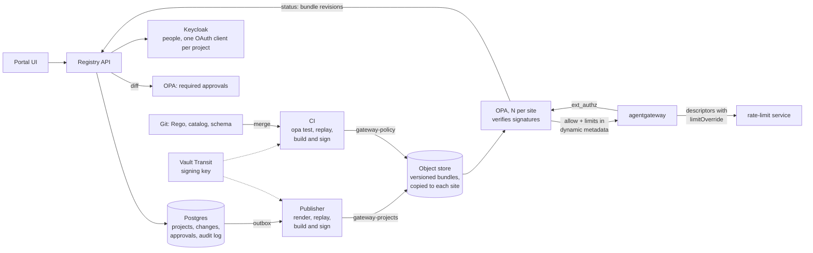

# Design: project registry (phase 2)

Status: **design, not built** (2026-11-13). One technical premise, rate limits
set by OPA per request, was verified in a spike (below). Everything else is
proposed.

Today a project is a file, `projects/<id>.yaml`, changed by pull request.
[multi-project-policy.md](multi-project-policy.md) records that design and
how it was built. It works for about 200 projects. This document is the next
step, for 1,000 projects or more on several sites, edited through a portal.

## Goals

- **One source of truth.** A registry service holds every project: its
  models, exceptions, limits and budget. The portal reads and writes the
  registry.
- **Small, fast changes.** A change touches one project and is live within
  minutes.
- **Controls a bank needs:** approval by the right people, an audit trail,
  replay of past decisions before publishing, and signed bundles.
- **Decisions don't depend on the registry.** If the registry is down, no
  request decision changes.
- **No OPA Control Plane.** CI builds and signs the policy bundle, and the
  publisher builds and signs the data bundle. OCP is retired (see
  [Why OCP goes](#why-ocp-goes)).

**Out of scope:** the Rego policy, the model catalog (`catalog/models.yaml`)
and the project schema stay in Git, reviewed by the platform team.

## Architecture



## Decisions

### Limits travel with the decision

This is the decision the rest depends on.

- **OPA returns the limits.** Each project's limits and budget are fields in
  the `gateway-projects` data bundle. The allow decision returns them as gRPC
  `dynamic_metadata`.
- **The gateway applies them.** agentgateway reads that metadata in CEL as
  `extauthz.*`, and each rate-limit descriptor sets `limitOverride` from it,
  for example `{"unit": "minute", "requestsPerUnit": extauthz.rpm}`.
- **The rate-limit service counts.** It honours an override for any
  descriptor in a known domain, with no entry for the project in its config.
  Its config shrinks to the domain and a default entry with a limit of 0, and
  stops changing with projects.

What this fixes:

- **A limit change is atomic.** It is one field in one project's data, so it
  goes live in the same bundle as the project's access.
- **No more paths out of step.** Today a project change reaches OPA, the
  rate-limit config and the alert rules separately. That gap, and a new
  project being let through without limits until the rate-limit sync, both
  go away.
- **No tiers.** An earlier draft had a fixed set of tiers. The spike showed
  the value itself can travel, so each project gets its own number.

**Every override expression needs a default of 0**, for example
`has(extauthz.rpm) ? extauthz.rpm : 0`. agentgateway skips a descriptor whose
expression fails to evaluate, which means no limit. With the default, a
project OPA allows but has no limits for is refused.

Metadata, not a request header. A client cannot forge `extauthz.*`, and a
header would also have to be stripped before the upstream call.

### Two signed bundles, no OCP

| Bundle | Roots | Built by | When |
|--------|-------|----------|------|
| `gateway-policy` | `gateway`, `catalog`, `system` | CI, on merge to `main` | a few times a week |
| `gateway-projects` | `projects`, `exceptions`, `agents` | the publisher | on every approved change |

- **Signing:** both builders run `opa build --signing-key`. The key lives in
  Vault Transit and is never exported, and each builder can only sign.
- **Verification:** OPA verifies each bundle with the public key in its
  `keys` config and refuses a bundle without a valid signature. A bundle that
  fails verification leaves the last good one active (`persist: true`).
- **Roots:** each bundle declares its roots in `.manifest`, and the roots are
  disjoint, as today (`policies/gateway-projects`).
- **Versions:** each bundle is written under its revision. A `latest` object
  points at the active revision, so a rollback is moving `latest` back.

### Callers authenticate with JWTs

- **One OAuth client per project or agent.** Each project gets a client in Keycloak
  (client credentials), and its tokens carry a `project` claim.
- **The gateway validates tokens** against Keycloak's JWKS. OPA reads the
  project from the claim instead of the API key's metadata.
- **The key path goes away.** Keys are created in Vault, synced by VSO and
  pushed to the gateway over xDS. That chain grows with every project and is
  removed.
- **The registry manages the clients.** It creates, rotates and revokes them
  through Keycloak's admin API. A client secret is shown once, in the portal.
- **Migration:** OPA accepts both the claim and the API key metadata while
  projects move over. API keys get an end date.

### One validation library

`gen-projects.py`'s loading, model resolution, agent checks and schema
validation become a library:

- the registry calls it when a change is submitted;
- the publisher calls it when it renders;
- CI keeps calling it on the YAML during migration.

The model choices a project sees are the intersection of the catalog in Git
and the model registry's versions in lifecycle `prod`, so a model the
onboarding pipeline promotes shows up without a catalog edit.

### Approval rules are policy

The registry sends a change's diff to OPA and asks
`data.portal.required_approvals`. The rules are Rego in Git, reviewed like
the gateway policy.

| The change | Approved by |
|------------|-------------|
| Add or remove models within the data class, lower a limit, edit a description | the project owner |
| Raise a limit or the budget | plus the cost owner |
| Raise `data_class`, add an exception (with an expiry date), wildcard `mcp_tools`, raise an agent's `autonomy` | plus security |
| Create a project | the platform team and security |

Two rules hold for every change:

- **Four eyes:** nobody approves their own change.
- **No bypass:** platform admins can't skip approval either.

### "Active" comes from OPA

- **OPA reports.** Every OPA runs the status plugin and reports the bundle
  revisions it has loaded to the registry's `/opa/status`.
- **Active means everywhere.** A change is `active` once every OPA on every
  site reports a revision at or after the change's.
- **Late changes alert.** A change that isn't active within a set time raises
  an alert.

### The registry is off the request path

- **Requests keep working.** OPA keeps deciding with its cached bundles. While
  the registry is down, nobody can change a project; nothing else stops.
- **Modest availability.** One Postgres primary with a standby and
  point-in-time recovery is enough.
- **Multiple sites.** The registry runs on one primary site. Bundles are
  copied to an object store on each site, and each site's OPA pulls only from
  its own.

## Data model (Postgres)

```
project(id, owner_group, data_class, placement, routing, limits jsonb,
        budget_usd_per_30_days, mcp_tools[],
        status[active|suspended|deleted], revision)
project_model(project_id, model)              -- explicitly granted models
exception(project_id, models[], why, owner, expires_at)
agent(project_id, name, autonomy, models, mcp_tools, ...)  -- as in agents/*.yaml today
oauth_client(project_id, client_id, created_at, rotated_at, revoked_at)
change_request(id, project_id, diff jsonb, state, required_approvals jsonb,
               replay_report jsonb, bundle_revision, created_by, created_at)
approval(change_id, approver, role, decision, comment, at)
audit_log(seq, at, actor, action, object, before jsonb, after jsonb)
outbox(seq, change_id, published_at)
```

- **The audit log is append-only.** It is exported to WORM storage and the
  SIEM.
- **Change states:** `draft → pending_approval → approved → publishing →
  active`. A change can also end in `rejected`, `failed` or `rolled_back`.

## Publishing

The publisher:

1. **Takes approved changes** from the outbox. Changes are batched, at most
   one publish every 30 seconds.
2. **Renders** every project's `data.json` with the shared library. Only the
   changed projects differ, and the output has a stable hash.
3. **Replays** the last N days of decision logs against the new data bundle
   and the active policy bundle (`scripts/policy-replay.py`):
   - decisions change only for the changed projects: continue;
   - decisions change for any other project: stop and mark the change
     `failed`. This is the safety valve.
4. **Builds, signs and uploads** the bundle under its revision, then moves
   `latest`.
5. **Waits for OPA** to report the revision, then marks the change `active`.

CI does the same for the policy bundle on merge: `opa test`, a replay with
the active data bundle, then build, sign and upload. A policy change is
expected to change decisions, so CI attaches the replay diff to the pull
request for review instead of stopping on it.

**Order of operations:**

- **A new project:** create the OAuth client first, then publish the bundle
  that allows it.
- **A removed project:** publish the bundle with status `deleted`, wait until
  it is active, then revoke the client.
- **A rollback:** point `latest` at the previous revision, one action in the
  portal, recorded in the audit log.

## Budgets and reporting

- **Budget alerts:** the registry exports `project_budget_usd{project}` on
  `/metrics`. One alert rule joins it `on(project)` with spend, so the number
  of rules no longer grows with projects.
- **Usage pages** in the portal read Prometheus (spend, requests),
  agentgateway Analytics and Langfuse.
- **The budget window** stays the rate-limit service's fixed 30-day window
  (`budget.usd_per_30_days`), now sent as an override with unit `month`.

## API (excerpt)

```
GET  /projects?owner=me               POST  /projects                 (new: a change)
GET  /projects/{id}                   PATCH /projects/{id}            (a change)
GET  /projects/{id}/allowed-models    POST  /projects/{id}/clients[/rotate|/revoke]
GET  /changes/{id}                    (diff, approvals needed, replay report, state)
POST /changes/{id}/approve|reject     POST  /rollback/{revision}
POST /opa/status                      (OPA status reports)
GET  /metrics
```

## Why OCP goes

Today OCP builds both bundles from Git and uploads them to MinIO. In phase 2:

| OCP does today | Phase 2 | Why not OCP |
|----------------|---------|-------------|
| Builds bundles from Git | CI builds `gateway-policy`; the publisher builds `gateway-projects` from Postgres | project data no longer comes from Git |
| Uploads to the object store | CI and the publisher upload | one upload needs no service |
| Pulls HTTP data sources on a timer | the publisher pushes on approved changes | a timer leaves no place for checks before publishing |

And phase 2 needs three things OCP 0.10 doesn't do:

1. **Signing.** OCP has no signing option in its config or its code.
2. **Checks before publishing.** Replay and approval have to pass before a
   bundle goes out. OCP publishes whatever it builds.
3. **Activation status.** This comes from OPA status reports, which don't
   involve OCP.

Retiring OCP also removes:

- its single replica and SQLite state;
- the manual override of `ocp.repo` and `ocp.reference` that deploying a
  branch to the cluster needs today. While that override is in place the
  root app's auto-sync has to stay off. With CI builds, a branch build goes
  to its own prefix in the object store instead.

Distributing bundles through an OCI registry later is `opa build` plus
`oras push`, so it doesn't need OCP either.

## Migration from `projects/*.yaml`

1. **Policy bundle to CI.** CI builds, signs and uploads `gateway-policy`,
   and OPA verifies signatures on that bundle. OCP keeps building
   `gateway-projects` only.
2. **Import.** Load `projects/*.yaml` into Postgres.
3. **Shadow run.** The publisher renders next to `gen-projects.py`, and every
   CI run compares the two; the output must match byte for byte. Cut over
   after a week without a difference.
4. **Cut over the data.** OPA pulls `gateway-projects` from the publisher's
   location and verifies its signature. OCP is removed.
   `projects/` becomes read-only, with a daily snapshot exported to Git for
   reading and disaster recovery.
5. **Limits to OPA.** Add the limits to OPA's metadata and `limitOverride` to
   the descriptors while the per-project rate-limit config is still there,
   compare the counts, then cut the config down to the default entry.
6. **JWTs.** New projects get only an OAuth client. Existing API keys get an
   end date.

## Proof of concept on minikube

**Pieces:** a FastAPI registry on the cluster's Postgres, the publisher, and a
minimal portal page (a Backstage plugin later).

**Checks:**

- Change one project's limit from 60 to 120 requests a minute: only its
  counts change, and the rate-limit pod doesn't restart.
- OPA refuses to load a bundle with a bad signature and keeps the previous
  one.
- A change that alters another project's decisions is stopped by the replay.
- With the registry stopped, the gateway keeps serving.
- A JWT call and an API key call for the same project get the same decision.

## Spike: limits set by OPA

**Question:** can agentgateway take rate-limit values from the ext_authz
response? Decision 1 depends on it.

**Source checks** (agentgateway v1.7.0, envoyproxy/ratelimit 5ae0682e):

- **Order.** ext_authz runs before remote rate limiting. Gateway-level
  policies merge into the route phase, so they also run after ext_authz.
- **Metadata in CEL.** OPA's gRPC `dynamic_metadata` is readable in CEL as
  `extauthz.*`.
- **Overrides.** Descriptors take `limitOverride`, a CEL expression returning
  `{"unit", "requestsPerUnit"}`, and the installed CRD has the field.
- **The service.** `GetLimit` uses an override for any descriptor in a known
  domain.

**The test:** agentgateway 1.7.0, OPA 1.22.2-envoy, ratelimit and Redis, in
Docker, the same images as the cluster. The cluster was not touched.

| Case | Result |
|------|--------|
| Project a, OPA data rpm 2 | `200 200 429 429` |
| Project b, rpm 5 | five 200s, then 429 |
| Project c, allowed, no limit in the data | 429 from the first call (default 0) |
| Project z, denied by OPA | 403 |
| Client sends `x-rl-rpm: 1000` | no effect, still 429 |
| Change a to 10 and c to 3 through OPA's data API | live at once, no rate-limit restart |
| Rate-limit service stopped, `failClosed` | 500 (the cluster uses `FailOpen` on purpose) |

**Not tested:**

- **Tokens and budget overrides.** They go through the same descriptor code
  as requests (`build_request`), but only requests were tested.
- **Changing a limit mid-window.** Whether the current window's count carries
  over was not established; the test crossed a minute boundary.
